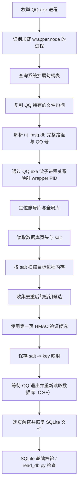

# QQ Dump Database

> 在极为安全的情况下，自动提取并解密 NTQQ 的 SQLCipher 数据库。

NTQQ 将聊天记录等数据保存在本地 SQLCipher 加密数据库中，密钥仅存在于进程内存里，用户无法直接导出自己的数据。
本工具让你能够**拿回属于你自己的聊天记录**。

面向 **Windows NTQQ** 的本地数据库导出工具。项目通过外部进程读取方式，从正在运行的 QQ 实例中定位数据库与密钥材料，验证候选密钥后解密 SQLCipher 数据库，并提供 SQLite 表数据检查脚本。

> 仅用于导出本人拥有或已获得明确授权的数据。解密后的数据库和 `key_map.json` 都包含敏感信息，请妥善保存，不要上传或分享。

## 功能概览

- **实例识别**：从 QQ 进程持有的 `nt_msg.db` 文件句柄解析账号目录，不依赖固定的用户目录或 PID 枚举顺序。
- **密钥定位**：只扫描与目标账号关联、且加载了 `wrapper.node` 的进程；按数据库 salt 搜索内存中的密钥候选。
- **密钥验证**：使用数据库第一页的 HMAC-SHA1 校验候选密钥，避免仅凭内存匹配结果误判。
- **数据库解密**：按页执行 AES-256-CBC 解密，重建标准 SQLite 文件头，并通过 SQLite 查询进行基础验证。
- **数据检查**：使用 `read_db.py` 列出解密库中的表、字段、行数和部分记录。

项目提供两套密钥提取和解密实现：

| 实现 | 入口 | 主要依赖 | 特点 |
|---|---|---|---|
| C++ | `main.cpp` | Windows API、BCrypt、SQLite3 | 推荐使用；密钥提取后会等待 QQ 退出，再重新读取数据库并解密，以便 WAL 完成 checkpoint |
| Python | `dump_db.py` | Python、`cryptography` | 便于阅读和修改算法；当前实现不会等待 QQ 退出后再解密 |

## 工作流程



### 1. QQ 实例与数据库路径映射

自动模式下，工具不直接拼接 `%USERPROFILE%\Documents\Tencent Files` 之类的默认路径，而是从当前运行的 QQ 实例反向定位数据库：

1. 使用 Toolhelp Process API 枚举 `QQ.exe` 进程，并通过模块快照检查进程是否加载 `wrapper.node`。
2. 从 `ntdll.dll` 动态获取 `NtQuerySystemInformation`，调用 `SystemExtendedHandleInformation`（信息类 `64`）取得系统句柄表。
3. 仅处理目标 QQ 进程拥有的句柄；通过 `OpenProcess(PROCESS_DUP_HANDLE)` 和 `DuplicateHandle` 将句柄复制到当前进程。
4. 使用 `GetFileType` 筛选磁盘文件句柄，再通过 `GetFinalPathNameByHandleW` 解析真实路径。
5. 只接受符合以下结构的消息数据库路径：

   ```text
   <data-root>\Tencent Files\<QQ号>\nt_qq\nt_db\nt_msg.db
   ```

6. 从路径中的 `<QQ号>` 得到账户标识，并结合 QQ.exe 的父子进程关系，将文件句柄所有者 PID 关联到持有 `wrapper.node` 的进程 PID。

映射时保留 `句柄所有者 PID + 数据库完整路径` 的关系，不单独按路径或 PID 顺序推断账号。若同一账号对应多个不同的 `nt_msg.db` 路径，或无法唯一关联到 wrapper 进程，自动模式会报错，而不是任意选择一个进程。

### 2. 数据库发现与 salt 分组

定位账号数据库目录后，程序根据实际路径推导同一数据根目录下的全局数据库目录：

```text
<data-root>/
├── <QQ号>/nt_qq/nt_db/       # 账号数据库
└── nt_qq/global/nt_db/       # 全局数据库
```

工具检查目录下的 `.db` 文件，读取文件前 `1024 + 4096` 字节：

- 文件偏移 `0` 处的 16 字节需要匹配 NTQQ 使用的数据库标识 `SQLite header 3\0`。
- 数据库页数据从文件偏移 `1024` 开始。
- 第一页大小为 `4096` 字节，其开头 `16` 字节作为该库的 salt。
- 账号数据库按 salt 分组。多个数据库文件如果使用相同 salt，会共享同一组候选密钥验证过程。

全局数据库与账号数据库采用不同的密钥获取路径：全局库使用程序内置的 pre-login passphrase 和数据库 salt 派生加密密钥；账号库则从匹配的 QQ 进程内存中寻找密钥候选。

### 3. 进程内存扫描

内存扫描基于 `VirtualQueryEx` 和 `ReadProcessMemory`，不向 QQ 进程写入数据：

- 扫描前使用 `OpenProcess(PROCESS_VM_READ | PROCESS_QUERY_INFORMATION)` 打开目标进程。
- 遍历进程虚拟地址空间，只读取已提交、非 `PAGE_NOACCESS` 且非 `PAGE_GUARD` 的内存区域。
- 每次读取最多 **4 MiB**。
- 候选记录采用 `x'<64位密钥十六进制><32位 salt 十六进制>'` 形式匹配，总长度为 99 字节。
- 相邻读取块之间保留 **98 字节重叠**，避免完整候选恰好跨越 4 MiB 边界时被漏掉；发生短读或读取失败时会清除重叠缓存，避免跨越未读取区间拼接出伪候选。
- 对每个 salt 保留不同的 key 候选，并跨目标进程合并去重；不会把内存中第一个匹配项直接当作正确密钥。

### 4. 密钥派生与 HMAC 验证

项目按 NTQQ 当前使用的 SQLCipher 页面布局实现密钥验证。主要参数定义在 `main.cpp` 与 `dump_db.py` 中：

| 参数 | 数值 |
|---|---:|
| 文件扩展头 | 1024 bytes |
| 数据库页大小 | 4096 bytes |
| Salt | 16 bytes |
| 加密密钥 | 32 bytes |
| AES IV | 16 bytes |
| HMAC | SHA-1，20 bytes |
| 页面保留区 | 48 bytes |
| HMAC salt mask | `0x3A` |
| 加密密钥派生 | PBKDF2-HMAC-SHA512，4000 次迭代 |
| HMAC 密钥派生 | PBKDF2-HMAC-SHA512，2 次迭代 |

账号库内存扫描得到 32 字节加密密钥候选后，程序使用第一页验证该候选：

1. 将第一页 salt 的每个字节与 `0x3A` 异或，得到 HMAC salt。
2. 使用候选加密密钥和 HMAC salt，通过 PBKDF2-HMAC-SHA512（2 次迭代）派生 HMAC key。
3. 计算第一页 HMAC-SHA1。参与计算的数据包括 salt 之后、页面保留区之前的内容，页面 IV，以及小端序的页号 `1`。
4. 将计算结果与页面内保存的 HMAC 比较。只有校验通过的候选才会写入结果映射。

加密密钥派生与页面 HMAC 验证使用不同的步骤：账号库的扫描结果直接作为待验证的 32 字节加密密钥；全局库则先使用固定 pre-login passphrase、salt 和 4000 次迭代 PBKDF2 派生加密密钥。

### 5. 数据库页解密

通过验证的密钥用于逐页解密：

- 从文件偏移 `1024` 开始，将数据按 `4096` 字节分页。
- 第一页跳过开头的 16 字节 salt；其他页面从页首开始处理。
- 每页从可解密区域末尾读取 16 字节 IV，使用 AES-256-CBC 解密页面内容；页面尾部的 48 字节保留区不作为密文写入。
- 第一页重建标准 SQLite 文件标识 `SQLite format 3\0`，并设置页大小为 4096 字节。
- C++ 版本保留解密后第一页中的 reserved-bytes 元数据。该字段会影响 SQLite 对 B-tree 可用空间和溢出页的解释。
- 写出文件后，使用 SQLite 打开数据库并查询 `sqlite_master`；至少存在一张表才视为基础验证通过。

C++ 版本在取得密钥后会提示关闭 QQ，并等待已枚举到的 QQ.exe 进程退出；也可以按 Enter 跳过等待。关闭 QQ 有助于让 SQLite WAL 内容 checkpoint 回主数据库文件。等待结束后，程序重新读取数据库第一页、按 salt 重新匹配密钥，再执行解密。

> `dump_db.py` 当前不会执行上述“等待 QQ 退出并重新读取数据库”的步骤，而且其第一页重建逻辑会将 `full[20]` 置为 `0`。因此在 WAL 尚未 checkpoint 或 reserved-bytes 元数据重要的数据库上，Python 版本与 C++ 版本的结果可能不同。需要更完整的数据导出时，优先使用 C++ 版本。

## 环境要求

### C++ 版本（推荐）

- Windows 10/11（依赖 Win32 API 和 Windows Native API）。
- 64 位构建环境，推荐 Visual Studio 2019/2022 或兼容的 MSVC 工具链。
- CMake 3.14 或更高版本。
- SQLite3 开发文件：可通过系统/包管理器提供，也可放入 `third_party/sqlite3/`，至少包含 `sqlite3.c` 和 `sqlite3.h`。
- Windows SDK（提供 BCrypt、进程、内存和文件句柄相关 API）。

CMake 会优先调用 `find_package(SQLite3)`；如果找不到系统 SQLite3，则尝试构建 `third_party/sqlite3/sqlite3.c`。两者都不存在时配置会失败。

### Python 版本

- Windows；建议使用 64 位 Python 3.10+。
- `cryptography`：用于 AES-256-CBC 页面解密。
- `hashlib`、`hmac`、`ctypes`、`sqlite3` 等其余模块来自 Python 标准库。

安装依赖：

```powershell
py -m pip install cryptography
```

进程句柄枚举和内存读取可能受到 Windows 权限限制。建议在有足够权限的终端中运行；即使使用管理员权限，受保护进程或访问策略仍可能导致部分进程无法打开，程序会输出警告并跳过相关 PID。

## 构建与运行

### C++ 版本

在项目根目录执行：

```powershell
cmake -S . -B build -A x64
cmake --build build --config Release
```

生成文件：

```text
build/Release/qq_dump_db.exe
```

基本运行：

```powershell
.\build\Release\qq_dump_db.exe --qq <QQ号>
```

可选参数：

```powershell
# 手动覆盖内存扫描 PID（诊断用途，会覆盖自动 PID 选择）
.\build\Release\qq_dump_db.exe --qq <QQ号> --pid <PID>

# 手动指定包含数据库 .db 文件的目录
.\build\Release\qq_dump_db.exe --qq <QQ号> --db-dir "D:\path\to\nt_db"

# 指定 key map 文件名/路径
.\build\Release\qq_dump_db.exe --qq <QQ号> --output key_map.json
```

参数说明：

| 参数 | 说明 |
|---|---|
| `--qq` | 必填；账号目录名中的 QQ 号 |
| `--pid` | 可选；显式指定内存扫描 PID，优先级高于自动映射，仅建议用于诊断 |
| `--db-dir` | 可选；手动指定包含 `.db` 文件的目录。自动实例映射可用时仍会尝试缩小扫描进程范围；不可用时可能扫描全部 wrapper 进程 |
| `-o`, `--output` | 可选；key map 输出文件名，默认 `key_map.json`。C++ 版本将相对路径写入 `output/<QQ号>/` 目录 |

### Python 版本

```powershell
# 自动识别账号、提取密钥并解密
py .\dump_db.py --qq <QQ号>

# 手动指定数据库目录
py .\dump_db.py --qq <QQ号> --db-dir "D:\path\to\nt_db"

# 显式指定扫描 PID（诊断用途）
py .\dump_db.py --qq <QQ号> --pid <PID>

# 指定 key map 输出路径（相对路径按当前工作目录解析）
py .\dump_db.py --qq <QQ号> --output key_map.json
```

Python 版本同样要求目标 QQ 正在运行，以便读取进程内存。与 C++ 版本不同，Python 版本将 key map 写到当前工作目录，并在提取完成后立即解密到脚本目录下的 `output/<QQ号>/`。

## 结果文件

默认输出目录：

```text
output/
└── <QQ号>/
    ├── key_map.json
    ├── nt_msg.db
    ├── ...其他成功解密的数据库...
```

`key_map.json` 的结构如下，键为数据库第一页的 salt（32 位十六进制字符串），值为对应的 32 字节加密密钥（64 位十六进制字符串）：

```json
{
  "key_map": {
    "<32-hex-character-salt>": "<64-hex-character-key>"
  },
  "_generated": "YYYY-MM-DD HH:MM:SS"
}
```

不同实现的 key map 写入位置见上文：C++ 默认写入 `output/<QQ号>/key_map.json`；Python 默认写入启动命令时的当前工作目录。Python 输出目录始终相对于 `dump_db.py` 所在目录。

## 检查解密后的数据库

`read_db.py` 使用 Python 标准库 `sqlite3` 打开 `output/<QQ号>/` 下的数据库，列出表和视图，并展示每张普通表的前若干行：

```powershell
# 检查该账号目录下所有 .db 文件
py .\read_db.py --qq <QQ号>

# 只检查指定数据库
py .\read_db.py --qq <QQ号> --db nt_msg.db

# 只展示指定表，最多显示 20 行
py .\read_db.py --qq <QQ号> --db nt_msg.db --table c2c_msg_table --limit 20
```

| 参数 | 说明 |
|---|---|
| `--qq` | 必填；对应 `output/<QQ号>/` 目录 |
| `--db` | 可选；仅检查指定 `.db` 文件 |
| `--table` | 可选；仅显示指定表或视图 |
| `--limit` | 可选；每张表最多显示的行数，默认 10 |

检查脚本会跳过名称符合常见 FTS5 shadow table 后缀的表；长度超过 120 的字符串会截断，超过 64 字节的 BLOB 只显示长度摘要，小型 BLOB 则显示十六进制内容。它是轻量级浏览工具，不负责解析 QQ 消息字段或解码业务层序列化内容。

## 项目结构

```text
.
├── main.cpp          # C++ 主程序：进程/句柄映射、内存扫描、密钥验证、数据库解密
├── dump_db.py        # Python 实现：自动映射、内存扫描、密钥验证、数据库解密
├── read_db.py        # SQLite 数据库表结构和样例数据检查工具
├── CMakeLists.txt    # C++ 构建配置，链接 SQLite3 与 Windows BCrypt
└── README.md
```

## 实现边界与注意事项

- **平台限制**：依赖 Windows 进程、内存、模块和句柄 API，不支持 Linux/macOS。
- **版本耦合**：数据库目录结构、`wrapper.node` 模块、内存中的密钥记录格式以及 SQLCipher 页面参数均基于当前分析到的 NTQQ 实现；QQ 更新后可能需要调整。
- **Native API 稳定性**：`NtQuerySystemInformation(SystemExtendedHandleInformation)` 属于 Windows Native API。项目在源码中本地声明句柄结构，避免依赖私有 SDK 头文件，但 Windows 版本或体系结构变化仍可能带来兼容性问题。
- **权限与完整性**：访问被拒绝的进程会被跳过；数据库文件在扫描期间发生变化，也可能影响密钥验证或解密结果。
- **WAL 一致性**：C++ 版本默认等待 QQ 退出以便 WAL checkpoint；按 Enter 跳过等待时，结果可能缺少仍留在 WAL 中的数据。Python 版本没有等待流程。
- **数据库范围**：自动模式从识别出的账号库目录和全局库目录读取直接位于目录中的 `.db` 文件，不递归扫描子目录，也不单独合并 `-wal` / `-shm` 文件。
- **数据保护**：导出的 `.db` 是可直接读取的明文 SQLite 文件；`key_map.json` 保存可用于解密对应数据库的密钥。请限制输出目录访问权限，并在不再需要时安全删除。

## 安全模型

程序采用外部读取流程：

- 不向 QQ 进程注入 DLL。
- 不通过 Hook 修改 QQ 函数行为。
- 不调用 `WriteProcessMemory` 修改目标进程内存；扫描阶段使用 `ReadProcessMemory` 读取可访问区域。
- 通过数据库第一页 HMAC 校验密钥候选，而不是仅凭字符串匹配决定密钥。

这些设计降低了对目标进程运行状态的干预，但不意味着读取行为没有权限要求，也不构成对所有 QQ 版本、系统环境或数据库状态的绝对安全/完整性保证。

## License

MIT 转载或引用请注明来源：[https://github.com/NapNeko/qq_dump_db](https://github.com/NapNeko/qq_dump_db)